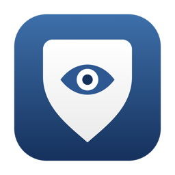

# xVigil

**A macOS security dashboard.** Apple ships real protection with every Mac
(XProtect malware scanning, Gatekeeper, quarantine), but it all works in
silence: scans you never see, verdicts you never read, records buried in
databases you'd never open. xVigil lives in your menu bar and puts that
machinery on screen, loudly, when something is found.

**What it does:**

- **Watches.** Sweeps XProtect's activity in the background. A detection
  turns the menu bar shield red, banners the popover, and files into a
  Detections pane.
- **Explains.** Every quarantine event on your Mac: what was downloaded, by
  which app, from where. Drill down to the file on disk, today's Gatekeeper
  verdict, its code-signature chain, and the log activity around the moment
  it arrived.
- **Scans.** On-demand and scheduled ClamAV scans of the places Apple's
  tools never proactively check, with one-click ClamAV and signature updates
  through Homebrew. Report-only: xVigil never quarantines or deletes
  anything.
- **Monitors.** A file watchlist for IOC hunting, integrity tracking, and
  content inspection, fed locally or from a remote HTTPS feed.

## See it in action

[Video walkthrough of the dashboard](docs/video/xVigil-1.2.mp4) (1:24),
section by section.

## Install

Grab `xVigil-x.y.z.zip` from [Releases](https://github.com/ServerWrestler/xVigil/releases),
unzip, and drag `xVigil.app` to Applications. Releases are ad-hoc signed, so
on first launch macOS will warn you. Right-click the app and choose **Open**
(yes, the Gatekeeper-visibility app makes you talk to Gatekeeper; consider
it a product demo). Or build it yourself:

```sh
scripts/make-app.sh 1.2.0   # produces dist/xVigil.app and a zip
```

Requires macOS 15+. ClamAV (`brew install clamav`) is optional, only needed
for scanning. Grant xVigil Full Disk Access for complete file search.

## Documentation

- [The dashboard, section by section](docs/dashboard.md): what Detections,
  Quarantine Events, XProtect Activity, On-Demand Scan, File Monitor, and
  Protection Status each do
- [Development notes](docs/development.md): layout, CLI harness, macOS
  gotchas, repo hygiene

## License

Copyright (C) 2026 Eric Chadbourne. xVigil is free software, released under
the [GNU General Public License, version 3 or later](LICENSE). XProtect and
Gatekeeper are Apple technologies and ClamAV is a Cisco project; xVigil is
independent and not endorsed by either.

## Next ideas

- `log stream` for live tailing instead of polled `log show`
- Notifications on new quarantine events and new detections
- Drop-a-file-to-verify: `spctl`/`codesign` verdict for any file
- More scan engines behind `ScanEngine` (YARA, rkhunter). File-on-write
  monitoring stays out of scope (it needs an Endpoint Security entitlement)
